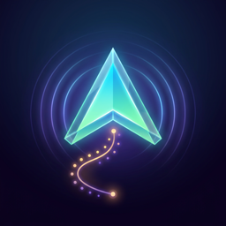
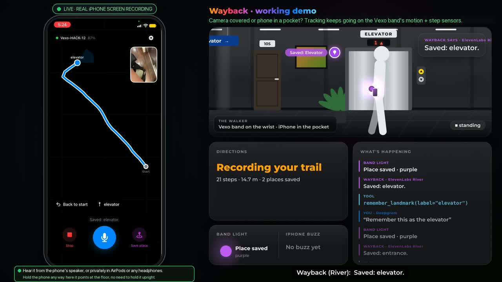
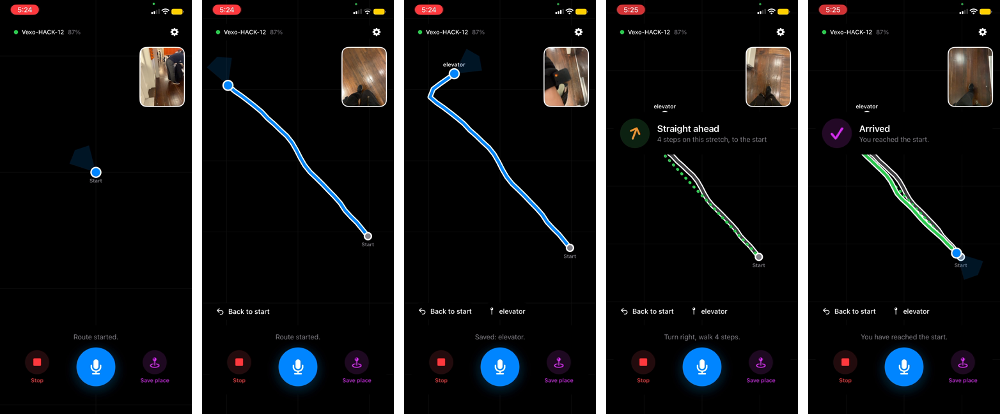

# Wayback: wearable spatial memory on the Vexo band

<p align="center"></p>

## Final submission (VexoHacks, Nov 14 2026)

### ▶ Video demo: **[youtu.be/bj-MdFCf9Js](https://youtu.be/bj-MdFCf9Js)**

[](https://youtu.be/bj-MdFCf9Js)

60 seconds: the team's working-demo film with a **real iPhone screen recording** of a walk (iPhone 11 + Vexo band, no laptop) in place of the simulated phone. The file is also in the repo: [submission/wayback-demo-FINAL-SUBMISSION.mp4](submission/wayback-demo-FINAL-SUBMISSION.mp4).

### The app



*From the real walk, left to right: route started · walking (blue trail) · "Saved: elevator" · guided back (dotted green way back) · arrived.*

- **iPhone app:** [`ios/Wayback`](ios/Wayback) connects straight to the Vexo band over Bluetooth (no laptop). One screen: map of your walk, Start/Stop, Talk, Save place, and saved places you tap to be guided back.
- **What it does:** double-tap the band and speak to start a route, name a place ("remember this as the elevator") or ask to go back ("take me back to the elevator"). The phone guides you back with spoken directions (speaker or AirPods) and a **steady haptic pulse while you face the right way** (silence means turn).
- **Tracking:** the iPhone's camera + motion sensors (ARKit visual-inertial tracking) lead while the camera can see, at any phone angle. **Camera covered or phone in a pocket? Tracking continues on the Vexo band's motion and step sensors**, fused with the iPhone's IMU, pedometer (stride) and barometer (floor change). While the camera tracks, the band's step counter and the camera's distance learn your stride.
- **The Vexo band's role:** every command goes through it (microphone, double-tap, LED light), and its motion + step data carry the tracking whenever vision can't.
- **Measured:** a 120 m camera-tracked walk with the phone in hand ended 3.0 m from its start. Pocket-only tracking drifts more (phone handling and arm swing), and is the next thing to improve, e.g. with a Kalman filter weighting each sensor by its uncertainty.
- **Run it:** open `ios/Wayback/Wayback.xcodeproj` in Xcode, set your Team under Signing, pick your iPhone, press Run. Set your band number in the app (gear icon). Voice keys (Deepgram, Gemini, ElevenLabs) go in the app's settings and are kept in the iOS Keychain.


*Vexo remembers what you said. We make it remember **where** you said it.*

Walk around a place that has no map, such as your house, an office or a hospital floor, and say
"this is the kitchen", "these are the stairs", "this is the entrance". Later say **"take me to the
kitchen"**. Wayback guides you back along the path you actually walked. It speaks the
directions, shows them on the band's light, and **buzzes the phone in your pocket**:
- a buzz that tells you which way to turn when you face the wrong way
- a different buzz once you face the right way
- a quickening buzz before a turn
- a stop pattern when you arrive

Built at VexoHacks, 14 Nov 2026. Plan: [VexoHacks_Plan_Wearable_Spatial_Memory.md](VexoHacks_Plan_Wearable_Spatial_Memory.md).

## What it does

| Feature | How |
| --- | --- |
| **Track where you walk** | Steps for distance, the wrist gyro (projected on gravity) for direction. The default wrist tracker uses a 2 s median heading held on a 90° grid, and calibrates the gyro only when you stand still ([tracker/wrist.py](tracker/wrist.py); the classic tracker is [tracker/pdr.py](tracker/pdr.py)) |
| **Save places by voice** | "This is the kitchen" pins a name to your current point on the route ([store/route_store.py](store/route_store.py)), mirrored to the band's own storage ([store/band_mirror.py](store/band_mirror.py)) |
| **Guide you there** | The route is a graph of the path you walked. Guidance follows you leg by leg, warns before turns, copes with turning a step early, and on arrival resets your position to the place, which cancels drift ([store/guidance.py](store/guidance.py)) |
| **Re-anchor** | "I'm at the elevator" snaps your position to a saved place. A reset is never drawn or routed as a walked line |
| **Voice, eyes-free** | **Double-tap the band**: the mic turns on (solid blue light, "tink" on the laptop). **Double-tap again or pause**: the mic turns off ("pop"). Deepgram turns speech into text, **Gemini 4** picks the action, and **ElevenLabs** speaks the answer, with **MiniMax** as the backup voice ([voice/loop.py](voice/loop.py)) |
| **Live transcript** | The terminal shows `[YOU] …` while you speak, then `Heard: …` and `Gemini chose …` |
| **Phone haptics** | A haptic coach compares where you face with the route's next leg, 5 times a second, and buzzes the phone ([store/haptics.py](store/haptics.py)). Patterns are listed below |
| **iPhone app** | Native SwiftUI app with real iPhone haptics (Core Haptics). It can run **on the iPhone alone, with no laptop**: it connects to the band over Bluetooth and does tracking, places, guidance, buzzing and voice itself. It can also work with the laptop app ([ios/](ios/)) |
| **Web pages** | The trail page (main UI), the team map, and a phone page that vibrates on Android and acts as a phone simulation on a laptop ([web/](web/)) |
| **Band status** | Connected or not, how it's linked, battery with a low warning, chip temperature |
| **Band light** | Green blink = route started, amber breathe = recording, purple = saved, white breathe = guiding, white blink speeding up = turn coming, green then rainbow = arrived, red blink = lost |

### Buzz patterns (phone)

| Situation | Buzz |
| --- | --- |
| Wrong way, turn left | 2 short, repeating |
| Wrong way, turn right | 3 short, repeating |
| Facing the right way | 1 long ("locked on"), then a light tick every few seconds |
| Turn coming (1–4 steps) | ticks that speed up |
| Turn left / right / around now | long + short / long + short + short / long + long |
| Stop: arrived | 3 long |
| Stop: lost (position uncertain) | rapid buzzing, repeating |

On iPhone, left cues feel softer and right cues crisper.

## Sponsor tracks

| Track | Where it is used |
| --- | --- |
| Google DeepMind: Best Use of Gemini 4 | `gemini-4-hydrogen` turns what you said into one of the app's tools (start route, save a place, guide, re-anchor…) with native function calling, and tolerates wrist-mic mishearings ([voice/gemini_client.py](voice/gemini_client.py)) |
| ElevenLabs: Best ElevenLabs Project | Every spoken reply and direction, in the voice "River" ([voice/elevenlabs_tts.py](voice/elevenlabs_tts.py)) |
| Deepgram: Best Voice Use Case on Pipecat | Band microphone → Deepgram live speech-to-text ([voice/loop.py](voice/loop.py)). The Pipecat pipeline port is on branch `voice-pipecat` (not merged) |
| MiniMax | Backup text-to-speech when ElevenLabs is unavailable ([voice/minimax_tts.py](voice/minimax_tts.py)) |

## Set up (once)

1. Python 3.9 or newer, then install `bleak` (Bluetooth) and `pyserial` (USB cable):

   ```bash
   python3 -m pip install --user bleak pyserial
   ```

2. Copy `.env.example` to `.env` and fill in `VEXO_DEEPGRAM_API_KEY`, `VEXO_GEMINI_API_KEY`,
   `VEXO_ELEVENLABS_API_KEY` and optionally `VEXO_MINIMAX_API_KEY`. `.env` is gitignored, and
   keys are read only through [keys.py](keys.py).
3. The band number is set once in [config.py](config.py): `BAND = 80` (Vexo-HACK-80). Never
   connect to another team's band.
4. macOS: allow Bluetooth for the Terminal app (System Settings → Privacy & Security → Bluetooth).

## Run it

Pick **one** way to connect the band. Only one program can hold the band at a time.

```bash
python3 main.py --band                  # the laptop connects to the band over Bluetooth
python3 main.py --band --usb            # the same over the USB cable
python3 main.py --bridge                # Chrome connects to the band (click "Connect band" on the page)
python3 main.py --bridge --phone        # the iPhone app connects to the band and relays it over Wi-Fi
```

- Double-tap the band just before starting, so it blinks blue and can be found.
- Add `--phone` to any of these to let a phone on the same Wi-Fi open the phone page or the
  iPhone app. It prints a link with a secret token. Other devices can only open the phone
  page, and only with that token.
- Open the trail page link that `main.py` prints: `http://localhost:8000/web/trail.html?ws_port=8765`.

Then, eyes-free:
1. Double-tap, say **"start route"**, double-tap. Hold your arm still for a moment while the gyro calibrates.
2. Walk. Double-tap, say **"this is the kitchen"**, double-tap. Save more places the same way.
3. Double-tap, say **"take me to the kitchen"**. Follow the voice, the light and the buzzes.
4. Lost? Stand at a saved place and say **"I'm at the stairs"**.

No band? These need no hardware and no keys:

```bash
python3 main.py --sim                                         # scripted demo on a synthetic walk
python3 main.py --replay data/logs/walk3-wrist-loop.csv       # a real logged walk (labelled as a replay)
python3 -m tracker.replay data/logs/walk3-wrist-loop.csv      # print the replayed trace in the terminal
python3 -m unittest                                           # 115 tests
```

## The iPhone app (Wayback)

Source: [ios/Wayback](ios/Wayback). Full steps: [ios/README.md](ios/README.md).

**Tabs**
- **Guide:** an arrow toward your route, what to do now ("Turn right", "Turn left in 2 steps",
  "Arrived"), a big **Talk** button (same as a double-tap), what it heard and the answer, battery,
  and a Buzz switch.
- **Map:** the walked trail, saved places, the start, where you are and which way you face,
  and the route being guided.
- **Places:**
  - Start / Stop route
  - **Save this spot as…**
  - each place with **Take me here** and **I'm here**
  - Take me back to the start
  - step-by-step directions
  - a box for any command
- **Band:**
  - connection, and **Connect band (iPhone Bluetooth)**
  - battery and chip temperature
  - steps, distance, facing and calibration
  - every buzz pattern with a **Try** button

**iPhone only (no laptop):** on the Guide tab, tap **Use this iPhone only**. Then go to Band → Keys,
add your Deepgram, Gemini and (optionally) ElevenLabs keys, and tap **Connect band**. Double-tap the band
and talk. Tracking is a Swift port of the team's wrist tracker, and it reproduces the same results on
the logged walks (walk 3 ends 1.0 m from its start).

**Install (developer mode)**
1. Turn on Developer Mode on the iPhone, plug it in, and tap Trust.
2. Open `ios/Wayback/Wayback.xcodeproj` in Xcode.
3. Choose your Team under Signing & Capabilities, pick the iPhone, and press Run.
4. Run `python3 main.py --bridge --phone` on the laptop.
5. In Wayback, paste the "Phone (on the same Wi-Fi)" link and tap Connect. Allow Bluetooth.
   The app finds only Vexo-HACK-80 and checks the band's own number.

iOS plays haptics only for the app on screen, so keep Wayback open. It keeps the screen awake while connected.

## Web pages

| Page | What it is |
| --- | --- |
| `web/trail.html` | Main UI: live trail and facing cone, the Band card (connection, battery), voice controls (Talk/Stop, live status, "Try saying" suggestions), landmarks, directions, tracking and debug |
| `web/index.html` | Team map: map, LED state, directions, landmarks, typed commands |
| `web/phone.html` | Phone page: arrow, cue, Start buzzing (vibrates on Android), legend. On a laptop it's a phone simulation that shakes and beeps |

Everything is served on `127.0.0.1` unless `--phone` is given. No API key ever reaches a page.

## Layout

```
main.py, app.py              entry point and the tools (start route, save place, guide, re-anchor…)
config.py, interfaces.py     settings (band number, models, voices) and shared data shapes
keys.py                      API keys: only VEXO_ names, never printed
tracker/                     wrist tracker, band link (Bluetooth / USB), replay, calibration
store/                       routes and places (route graph), guidance, haptic coach
voice/                       voice loop, Gemini, ElevenLabs, MiniMax, LED states
web/                         trail page, team map, phone page, WebSocket server, Chrome bridge
ios/Wayback/                 the iPhone app (SwiftUI, Core Haptics, CoreBluetooth)
data/logs/                   real logged walks (replays)
vexo-open-kit/               the band's kit (MIT), unchanged
docs/                        earlier ideas and the original iPhone plan
AGENTS.md                    rules for AI coding agents
```

## Limits (read before judging)

- **Heading is the wrist's heading.** Arm swing adds noise. Wear the band on the same wrist, the
  same way, every time.
- **Drift.** There is no compass on the band, so heading drifts. The 90° grid, re-anchoring and
  the reset on arrival limit it, so short routes work best. The red light and "lost" buzz say
  when to re-anchor. On the team's own logged wrist walk (walk 3, a 59 m loop) the trace ended
  1.0 m from its start ([tests/test_wrist.py](tests/test_wrist.py)). That's one walk, not a
  general accuracy figure.
- **The band has no vibration motor and no speaker.** Buzzing comes from the phone, and speech
  from the laptop or earbuds paired with it. iPhone web pages can't vibrate, which is why the
  iPhone app exists. Android can vibrate from the phone page.
- **The laptop is the brain.** It runs tracking, routes, voice and the AI calls. With
  `--bridge --phone` it only needs the same Wi-Fi as the phone. Otherwise it must stay within
  Bluetooth range of the band (about 10 m).
- **Placeholder tuning.** Step length and some thresholds in [config.py](config.py) still need a
  measured walk.
- This is an experimental navigation aid, not a safety-critical wayfinding system. Data stays on
  the laptop, and "delete all" forgets every route.
