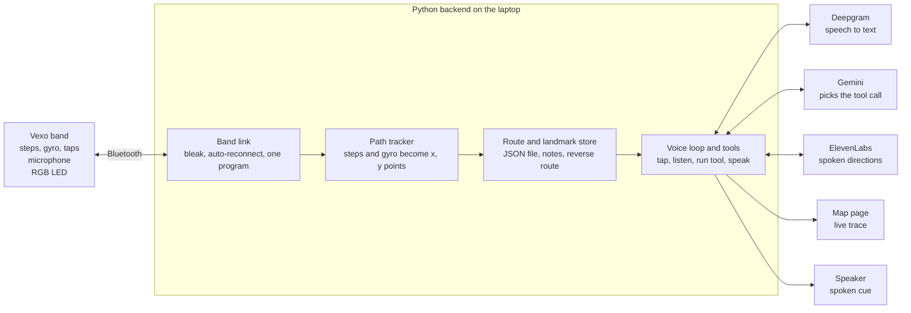

# VexoHacks Plan: Wearable Spatial Memory on the Vexo Band

Nov 14, 2026

## Decision summary

We build the original indoor spatial-memory idea with the Vexo band as the wearable: walk a route, say "remember this is the entrance," later ask "take me back," and get spoken and LED guidance along the path you actually recorded.

The original plan was written for an iPhone and Apple Watch. The band changes four things: it has no compass (heading comes from the gyro only), no vibration motor, no speaker, and no barometer. It does have an accelerometer, gyroscope, step counter, microphone, RGB LED, tap detection and 1,000 on-band storage slots.

- **Stack:** one Python process holds the band link, all API keys and the route state, and feeds a browser map page.
- **Platforms:** Deepgram turns the band's microphone into text, Gemini (AI Studio) decides what the user meant, ElevenLabs speaks the directions.
- **Division of labour:** Gemini picks the tool and matches place names. Code computes every coordinate and route. The model never invents a position.
- **Cut from the original plan:** iPhone app, Apple Watch haptics, AirPods, barometer floors, object-loss detection, Vexo MCP.
- **Time:** it is 11:15 AM Pacific and submissions close at 6:00 PM. Target a complete submission by 5:30 PM.

## Band reality check

Five of the original plan's sensing and output assumptions do not hold on the band, so each gets a replacement. Source: the kit's `AGENTS.md` and `contract/contract.md`, which state "Not on this band: heart rate, skin temperature, vibration, a screen, a speaker."

| Need | Original plan | What the band offers | Decision |
| --- | --- | --- | --- |
| Heading | Phone compass plus gyro | Accelerometer and gyroscope only, no magnetometer | Integrate gyro yaw. Snap turns to multiples of 90 degrees. Re-anchor at landmarks. |
| Distance | `CMPedometer` distance | Steps, cadence and `still`/`walk`/`run` state, once per second. `steps` is a lifetime total. | Fixed step length from one measured walk. Subtract the first step count seen. |
| Haptic cue | Apple Watch | None | LED color and pattern, plus spoken cue |
| Spoken output | AirPods | No speaker | ElevenLabs audio on the laptop speaker |
| Voice input | Phone microphone | Opus microphone. LED is locked solid blue while it is on. | Deepgram speech to text. Listen, switch mic off, then respond. |
| Display | Phone screen | None | Browser map page on the laptop |
| Floors | Barometer | None | User-spoken floor label such as "B2" |
| Storage | SwiftData | 1,000 keys of up to 232 bytes on the band | Laptop JSON is the source of truth. Mirror landmarks to the band if time allows. |
| Connection | Native iOS app | Bluetooth to a laptop from Python (`bleak`) or Chrome/Edge. One program at a time. | One Python process, the laptop travels with the walker. |
| Link drops | Not covered | The band resets its LED, streams and settings when the link closes | Connect with `auto_reconnect=True` and re-apply settings. |

## Feasibility by feature

Everything in P0 is buildable today on the band. The one real risk is wrist-based heading, so Gate B tests it before anything else depends on it.

| Feature | Priority | Verdict | Fallback if it fails |
| --- | --- | --- | --- |
| Band link, live steps and gyro | P0 | Feasible. Documented streams. | Pretend band (`--sim`) while hardware is set up |
| Breadcrumb route from steps and gyro heading | P0 | **Feasible, highest risk.** Arm swing adds yaw noise. | Ordered checkpoints with step counts and 90-degree turns |
| Named landmarks saved at a route point | P0 | Feasible. Plain code. | None needed |
| Reverse route to a landmark or the start | P0 | Feasible. Walk the saved points backwards. | None needed |
| Voice commands via Deepgram | P0 if time | Feasible. The kit already does mic to text. | Typed text box on the map page |
| Gemini intent and place matching | P1 | Feasible with function calling | Keyword match on landmark names |
| ElevenLabs spoken directions | P1 | Feasible. Needs a key. | Browser text-to-speech or on-screen text |
| LED state cues | P1 | Feasible. Solid, blink, breathe, rainbow. | Map page indicator |
| Notes attached to a place | P1 | Cheap. Text on a landmark. | None needed |
| Re-anchor at a confirmed landmark | P2 | Cheap, and it limits drift | Skip |
| Landmarks mirrored in band storage | P2 | Feasible. 232 bytes per key. | Laptop file only |
| Tap-coded silent commands | P2 | Feasible. Tap and double-tap events. | Skip |
| Haptics and braille output | Cut | Impossible. No vibration motor. | Not applicable |
| Barometric floors, object-loss detection, Watch, Vexo MCP | Cut | Out of scope for today | Not applicable |

## Architecture

The band talks only to the laptop over Bluetooth. Deepgram, Gemini and ElevenLabs are called from the backend, so no key ever reaches the browser page. Keys stay in `.env` on the laptop. Gemini picks the tool; code computes every coordinate and route.

## Path tracking

The route is a list of (x, y) points in meters from the start, built from step counts for distance and gyro turns for direction. It is approximate and drifts, which is acceptable for retracing a route you just walked and not for building a floor plan.

**Algorithm**

1. On "start route," set the position to (0, 0) and heading to 0. Stand still for about two seconds and average the gyro to measure its bias.
2. Configure `activity=True` and the motion stream. Each `activity` event gives a lifetime `steps` total, so new steps = current minus last seen.
3. Distance = new steps times a fixed step length. Measure the step length once by walking a known distance and dividing by the steps counted.
4. Compute yaw rate as the gyro vector projected onto gravity, where gravity is a low-pass of the accelerometer. Subtract the bias and integrate only while the activity state is `walk`.
5. Advance the position with the plan's formula: `x += distance * sin(heading)`, `y += distance * cos(heading)`.
6. **Turn snapping:** after a turn settles, round the net heading change to the nearest 90 degrees. This keeps hallways straight and stops small gyro errors from accumulating. Add a switch to turn it off outdoors or in curved spaces.
7. A landmark stores the index of the current route point plus its label, floor label and transcript.
8. **Re-anchor:** when the user says "I'm at the elevator," set the position and heading to that landmark's saved values.
9. **Return:** walk the saved points backwards. Merge points into segments and speak each as a turn plus a step count, for example "turn left, walk 18 steps."

**Wrist caveat.** The band's heading is the wrist's heading, not the body's, and arm swing adds noise. Wear it on the same wrist for every run and start each route with the arm in a natural position. The original plan's warning applies in full: state the carry assumption in the README and measure the drift at Gate B.

**Values to tune on a real walk:** step length, gyro bias, the turn-snap threshold, and how long a turn must settle. None of these are known yet, so do not quote accuracy numbers until Gate B produces them.

**Logging for the backup demo.** Write every step and gyro sample to a timestamped file during every test walk. A recorded real trace can be replayed deterministically if live Bluetooth fails, and must be labelled as a replay.

## Voice and agent

A double-tap on the band starts one listening turn, Gemini picks a tool, code runs it, and ElevenLabs speaks the result.

**One turn**

1. Double-tap the band. The kit reports this as a `double-tap` event.
2. The microphone turns on and the LED goes solid blue. This is forced by the band and cannot be changed while the mic is on.
3. The Python process records a few seconds and sends the audio to Deepgram for text.
4. Switch the microphone off. The LED accepts commands again.
5. Send the text, the landmark names and a short route summary to Gemini with the tool list below. Gemini must answer with a tool call.
6. Code validates the arguments, runs the tool against the stored route, and returns a plain result.
7. ElevenLabs speaks the result and the LED shows the state (see the next section).

**Tools Gemini may call**

| Tool | Purpose |
| --- | --- |
| `start_route(title)` / `stop_route()` | Begin or end recording |
| `remember_landmark(label, floor?)` | Save the current route point under a name |
| `save_note(text, landmark?)` | Attach a note to a landmark or the current point |
| `find_landmark(query)` | Match a spoken phrase to saved landmarks |
| `navigate_to(landmark_id or start)` | Begin return guidance along the recorded path |
| `reanchor(landmark_id)` | Reset position to a confirmed landmark |
| `ask_user(question)` | Ask a clarifying question when two landmarks match |

**Rules**

- Gemini chooses the tool and matches names. It never supplies coordinates, distances or turn directions. Code computes all of them.
- If a landmark id does not exist, code rejects the call and the agent asks the user.
- If speech-to-text or the model fails, a text box on the map page runs the same tools with keyword matching.
- Keep the model name and voice id in one config file. Keep keys in `.env`.
- Use the kit's example `voice_commands.py` as the template: it already goes band microphone to Deepgram to a tool-calling model. Replace its OpenAI call with Gemini.
- The band's audio goes to Deepgram only while the mic is on and a key is set. Use tap-to-talk, not always-on listening.

## Feedback vocabulary

Your four "vibration" states become four LED patterns plus a spoken line, because the band cannot vibrate. Blue is left to the band's microphone indicator, so no state uses it.

| State | LED | Spoken cue |
| --- | --- | --- |
| Start location set | Green, blink | "Route started." |
| Travelling (recording) | Amber, breathe | None, to avoid chatter |
| Landmark saved | Purple, solid for about 1.5 s | "Saved: entrance." |
| Navigating back | Amber, breathe | Turn and step count, e.g. "Turn left, walk 18 steps." |
| Turn now | White, blink | "Turn left." |
| Arrived | Green solid, then rainbow | "You have reached the entrance." |
| Position uncertain | Red, blink | "I'm not sure where we are. Say where you are to re-anchor." |
| Listening | Solid blue, set by the band | None |

**Accessibility honesty.** The LED helps a wearer who can see their wrist and anyone nearby. For a blind or low-vision user, audio is the channel that carries the guidance, and the demo should say so. The band cannot provide tactile output, so do not claim haptic or braille support.

**Limits.** The LED resets when the link drops, and brightness is capped on low battery. Re-apply the current state after every reconnect.

## Build-day roadmap

Submit target is 17:30, thirty minutes before the 18:00 close. Times are Pacific, 14 Nov 2026. Gates are checkpoints for all three owners.

| Window | Time | Pass test | If it fails |
| --- | --- | --- | --- |
| A: band streams | 11:15 to 11:45 | Real step and gyro values update on screen and are logged with timestamps | Keep building on the pretend band and debug the link in parallel |
| B: walk test, calibrate | 11:45 to 13:00 | A measured L-shaped hallway walk draws a recognisable L, with the end-point error and route length written down | Switch to ordered checkpoints with step counts and 90-degree turns |
| C: landmarks, return | 13:00 to 14:00 | One person walks A to B, saves B, continues to C, picks B and gets reverse guidance along the recorded path | Fix before adding any voice or model feature |
| Voice and agent loop | 14:00 to 15:00 | One full spoken turn works: ask, tool call, spoken answer, LED state | Typed commands on the map page |
| One extra feature | 15:00 to 16:00 | Notes or re-anchoring works end to end | Skip it |
| Record demo, replay | 16:00 to 17:00 | A Gold-level run is on video, and a real trace is saved for replay | Record the Silver or Bronze version |
| README and Devpost | 17:00 to 17:30 | Public repo, README, video and Devpost entry all complete | None. This is the deadline work. |
| **Submit target** | **17:30** | Every link on the final page checked | |
| Hard close | 18:00 | | |

Each window ends in a gate with a pass test. The voice, map and LED work starts earlier against the pretend band, so it is ready when Gate C passes.

## Team roles and interfaces

Three owners with fixed handoffs, so nobody blocks anybody. Name one integrator and one submission owner at the first checkpoint.

| Role | Owns | Hands off |
| --- | --- | --- |
| Band and tracking | Band connection, step and gyro streams, bias and step-length calibration, turn snapping, sample logging | A stream of `PoseSample {t, x_m, y_m, heading_deg, steps}` plus `start_route()` and `stop_route()` |
| Memory and map | Route store, landmarks, notes, reverse-route and instruction generation, browser map page | `remember_landmark()`, `find_landmark()`, `plan_return()`, and a websocket feed to the page |
| Voice and demo | Double-tap trigger, Deepgram, Gemini tool calling, ElevenLabs, LED states, demo script and video | A working spoken loop, and a text fallback that runs the same tools |

**Working rules**

- Agree the three interfaces above in the first 15 minutes, then work in separate files and branches.
- Only one person edits shared config (`.env.example`, the band number constant, the model names file).
- Nobody spends more than 30 to 45 minutes on a non-essential integration without showing an isolated working test.
- The integrator merges at each gate in the roadmap, not continuously.

## Demo script and fallbacks

A judge watches one walk from an entrance to a landmark and back, using only the path we recorded and no pre-existing map.

**60 to 90 second script**

1. At the entrance, double-tap and say "start route, this is the entrance." The LED blinks green.
2. Walk a hallway with one turn. Show the live trace on the map page. The LED breathes amber.
3. At the destination, double-tap and say "remember this as the elevator near the blue sign." The LED goes purple and the voice confirms.
4. Walk a little further, then double-tap and ask "where was the elevator?" and then "take me back to the entrance."
5. Follow the spoken turn and step-count instructions. The LED shows the navigating state and the arrival pattern at the end.
6. Close with the limits: wrist heading drifts, there is no haptic output on this band, and the route is only as good as the recorded walk.

**Fallback levels**

| Level | What runs | When to use it |
| --- | --- | --- |
| Gold | Live band, live trace, voice in, spoken and LED guidance back | Everything works |
| Silver | Live band and trace, typed commands, browser text-to-speech | Voice APIs or network fail |
| Bronze | Replay of a recorded real trace with live landmark search and guidance, clearly labelled as a replay | Bluetooth or the band fails |

Record a Gold-level video as soon as one run works, then keep the Bronze replay file in the repo. Never present a replay as live sensing, and never quote accuracy numbers that were not measured.

## Risks

Wrist heading and Bluetooth range are the two risks most likely to hurt the demo, so both are tested first.

| Risk | Impact | Mitigation |
| --- | --- | --- |
| Wrist yaw does not match walking direction | Route shape is wrong | Same wrist every run, bias calibration, 90-degree turn snapping, Gate B test, checkpoint fallback |
| Gyro drift over a long walk | Position error grows | Short demo route, re-anchor at landmarks |
| Bluetooth range is limited to the laptop's reach | Link drops mid-walk | Laptop travels with the walker, `auto_reconnect=True`, short demo route |
| Link drop resets LED and streams | Silent loss of tracking | Re-apply settings on `reconnected`, show a link status on the map page |
| Mic locks the LED blue | LED command denied during listening | Sequence listen, mic off, then LED |
| Step length is wrong | Distances are off | Calibrate on one measured walk and show the value on screen |
| Speech or model API fails | Voice loop blocked | Typed fallback running the same tools |
| Model suggests a wrong place | Misleading guidance | Code validates landmark ids and asks when two match |
| Keys leak to GitHub | Google project is closed automatically | `.env` in `.gitignore`, keys never in the browser page |
| Another team's band answers | Wrong device | Filter by the exact band name and check `band.number` after connect |
| Feature creep | Nothing finished | P2 starts only after the Gold demo is recorded |
| Missed 6:00 PM deadline | Disqualification | Submit by 5:30 PM, backup video recorded early |

Present this as an experimental navigation aid, not a safety-critical wayfinding system. Keep recording opt-in, store data locally, and give the user a stop and delete control.

## Setup, keys and rules

The kit has hard rules about band numbers and the hackathon account has rules about keys. Breaking either one costs the team its band access or its Google project.

**Band and kit**

- [ ] Read the band number on the bag and write it down once as a single constant (for example `BAND = 17`). Never use the kit's example 42.
- [ ] Clone the kit into the project folder. Install Python 3.9 or newer and `pip install bleak`.
- [ ] Double-tap the band before every connection, then run `examples/python/led.py` with the team's number to confirm the link.
- [ ] Use only the team's own band. Filter every scan by the exact name `Vexo-HACK-NN` and check `band.number` after connecting.
- [ ] Run one program at a time. Close the kit's dashboard before running Python, and the reverse.
- [ ] Serve any local page with `python3 -m http.server 8000 --bind 127.0.0.1`.
- [ ] Use the pretend band (`--sim`) until the real band is connected.

**Accounts and keys**

- [ ] Log in to the temporary Google account in a fresh browser profile, import the project at aistudio.google.com/api-keys, and copy the tier 3 key.
- [ ] Get the team's Deepgram key from the organizers, and create or confirm an ElevenLabs key.
- [ ] Put all keys in `.env` (copy `env.example`), add `.env` to `.gitignore` before the first commit, and never paste a key into the browser page or GitHub.
- [ ] If requests start failing with error 429, open aistudio.google.com/spend and raise the project spend cap.
- [ ] Do not make large numbers of requests. Excess usage can get the team disqualified.
- [ ] Copy all code and assets to GitHub before the event ends. The temporary account is deleted soon after.

## Submission and definition of done

Submit a complete version by 5:30 PM Pacific. Submissions close at 6:00 PM and judging starts at 6:30 PM, per the organizer schedule quoted in the original plan. Check the event portal for the actual requirements.

**Minimum acceptable submission**

- [ ] A real band run that records a walk, or a replay clearly labelled as a replay.
- [ ] A saved route shown on the map page.
- [ ] At least one named landmark attached to the route.
- [ ] Retrieval of that landmark and spoken guidance back along the saved path.
- [ ] One working voice or natural-language interaction, with a typed fallback.
- [ ] A README that states the limits: wrist heading, drift, no haptics, carry assumption.
- [ ] A demo video and a repeatable judge script.
- [ ] A public GitHub repo with commits made after the allowed build start, a README covering the problem, how it works, setup and limitations, and the Devpost entry with every required field.

**Submission owner** is named early and checks every link on the final page before 5:30 PM.

**Explicitly not required:** haptics, braille output, floor detection, shared maps, a true floor plan, object-loss detection, or any iPhone or Watch app.

## Open questions and sources

**Open questions**

- [ ] What is the team's band number?
- [ ] Are the Deepgram, Gemini and ElevenLabs keys in hand?
- [ ] Who carries the laptop during the demo walk, and how long is the demo route?
- [ ] Where is the measured hallway for the Gate B test and step-length calibration?
- [ ] Which wrist, and which orientation, will the band be worn in for every run?
- [ ] Which Gemini model and which ElevenLabs voice will be used?

**Sources**

- [Vexo Open Kit](https://github.com/VexoAI-Org/vexo-open-kit), cloned and read on 2026-11-14: `AGENTS.md`, `contract/contract.md`, `projects/README.md`, `examples/python/voice_commands.py`, `docs/api.md`.
- The team's `plan.md` (VexoHacks project plan), the source of the schedule, gates, data model and agent tool list.
- Google DeepMind hackathon temporary account guide (goo.gle/hackathon-account), the source of the key, quota and account-deletion rules.
