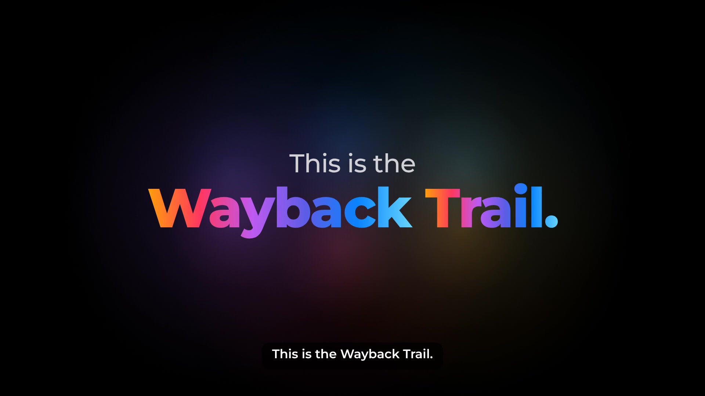
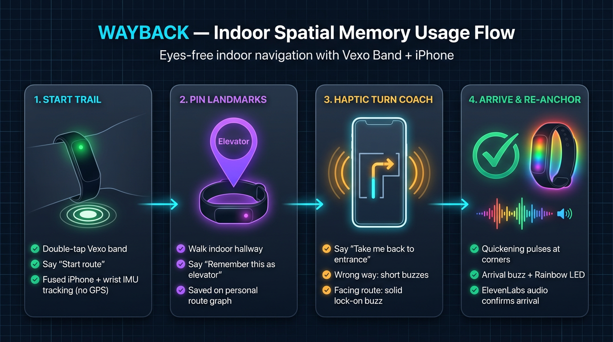
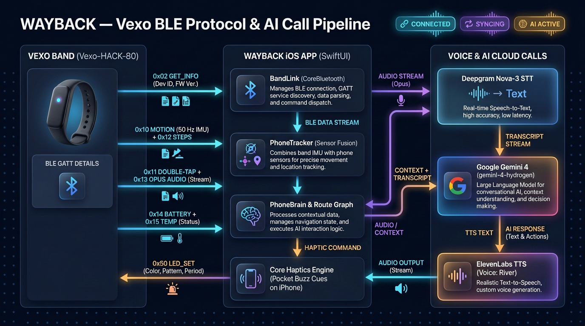
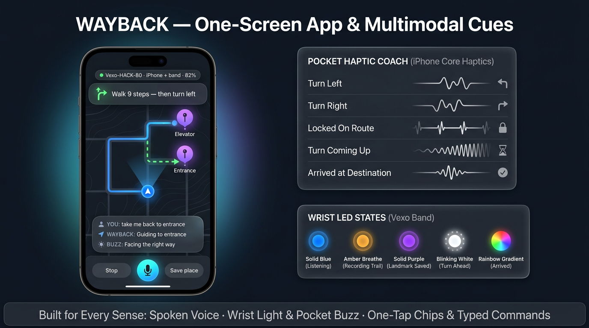

# Submission: Wayback Trail × Vexo commercial

**[wayback-trail-commercial.mp4](wayback-trail-commercial.mp4)**: 60 seconds, 1920×1080, H.264 + AAC,
with burned-in captions. It is the same video as [demo-versions v3](../demo-versions/README.md).

## What it shows

1. **Spatial memory:** say "remember this as the entrance" and the band's light confirms it.
2. **Distance tracking:** the Wayback app draws the path as you walk, counting steps and metres.
3. **Haptic guidance from the app:** ask "take me back to the elevator". The Wayback iPhone app
   buzzes until you face the route (2 short, soft pulses for "turn left"), gives one long buzz
   when you're locked on, then ticks you back. The band itself only listens and glows.
4. **Built for every sense (🙈 🙉 🙊):** spoken guidance if you can't see, light and buzzes if you
   can't hear, typing and buttons if you can't speak.
5. **Where it matters:** crowded places, unfamiliar places (shown with a blind, a Deaf and a
   non-speaking walker), and isolated places (out of a cave and down a mountain).
6. **Reach:** across the nation and around the globe (WHO: 2.2 billion people with a vision
   impairment, 1.5 billion with hearing loss).
7. Narrator, in the team's ElevenLabs voice River: **"This is the Wayback Trail."**

## Honesty notes

- The app overlay replays a recorded test walk (`data/logs/walk3-wrist-loop.csv` run through
  `tracker/wrist.py`) and is labelled on screen as a replay, not live sensing.
- The buzz patterns are the real ones from `store/haptics.py` and `ios/Wayback/Wayback/Haptics.swift`.
  In the ad, the wrong-way buzz repeats faster than in the app (every 2.5 s) to fit the time.
- The scenes are a dramatization. This is an experimental navigation aid, not a safety-critical
  system. The end card says both.

## Architecture, Vexo BLE Calls & Usage Flow Diagrams

### 1. End-to-End Indoor Usage Flow

### 2. Vexo Band BLE Protocol (`0x02`–`0x50`) & Voice/AI Call Pipeline

### 3. Single-Screen iPhone App, Core Haptics & Wrist LED Vocabulary

## Source & Filming Guide

- **[DEMO_VIDEO_GUIDE.md](DEMO_VIDEO_GUIDE.md)**: step-by-step live hackathon demo filming script, hardware & iPhone pre-flight checklist, sponsor track shot list, backup replay/demo modes, and `ffmpeg` Picture-in-Picture assembly commands
- [commercial/](../commercial/README.md): the page, the renderer and `build.py` (narration and video)
- [demo-versions/](../demo-versions/README.md): every cut, with what changed
